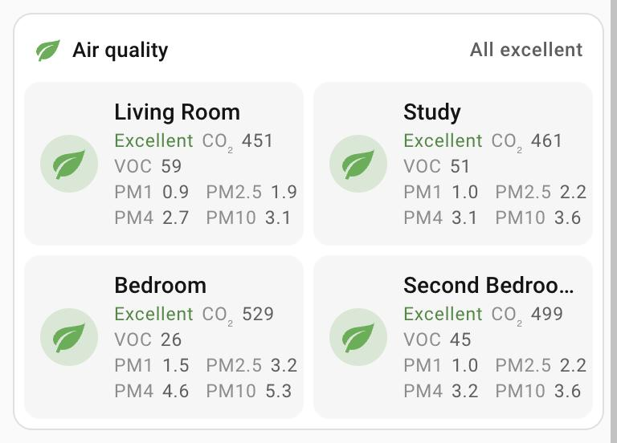
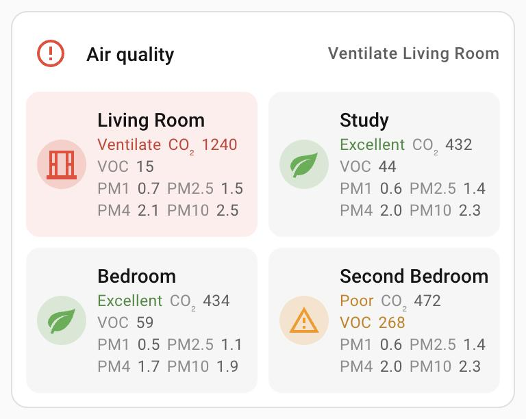

# Air quality card

`custom:air-quality-card` – every room's air in one card.

<table>
  <tr>
    <td valign="top"></td>
    <td valign="top"><br><sub>When a room needs air (example values)</sub></td>
  </tr>
</table>

- **Label row**: the title, with the house in a few words under it – "All
  excellent", "2 rooms elevated", "Poor in Second Bedroom" or "Ventilate Living
  Room, Study". The summary wraps between room names, never inside one. The icon
  shows the house's level in its colour.
- **Room tile**: status in its colour (Excellent / Elevated / Poor / Ventilate),
  CO₂ (ppm) and VOC, and on a line of their own every particle size – PM1, PM2.5,
  PM4 and PM10 (µg/m³), each labelled. NOx appears only while it is the cause.
  Every reading keeps its unit. Out-of-range readings take their level's colour.
- The words differ by level, not just the colour: leaf green "Excellent", info
  amber "Elevated", alert orange "Poor", and at the top level an open window in
  red, "Ventilate", whatever the cause.
- A room at the top level **glows red**.
- **Tap a reading** for its own sensor's more-info. Tap anywhere else on a room for
  its own dashboard (`navigation_path`), otherwise its CO₂ sensor.
- Nothing is cut off: the tiles are fitted to what they hold – the room name on
  one line, every reading whole, the particle sizes at least 2×2 – so the card
  uses fewer columns where they don't fit (one column on a phone, two on a wider
  card, up to `columns`). The particle sizes sit four across when they fit, else
  2×2. Tiles all have the same height.

## Configuration

Everything can be set in the visual editor (`thresholds` as YAML).

```yaml
type: custom:air-quality-card
title: Air quality
columns: 2
rooms:
  - name: Living Room
    prefix: sensor.living_room_air_quality_
    navigation_path: /lovelace/living-room-air-quality
  - name: Study
    co2: sensor.study_co2
    pm2_5: sensor.study_pm25
    voc: sensor.study_voc_index
```

| Option | What it is |
|---|---|
| `title` | Label row title. Default `Air quality`. |
| `columns` | Tiles per row at most, default 2 (up to 4). Fewer when a room's name or a reading wouldn't fit. |
| `rooms[].name` | Shown on the tile. |
| `rooms[].prefix` | The card finds `<prefix>co2`, `pm1`, `pm2_5`, `pm4`, `pm10`, `voc_index`, `nox_index` (e.g. Sensirion SEN6x sensors in ESPHome). |
| `rooms[].co2`, `pm2_5`, `voc`, `pm1`, `pm4`, `pm10`, `nox` | Individual sensors; they win over the prefix. |
| `rooms[].navigation_path` | Where a tap on the tile goes (a tap on a reading opens that reading's sensor). |
| `thresholds` | Override any pollutant's `[elevated, poor, ventilate]` limits; `null` skips a level, e.g. `co2: [1000, null, 1500]`. |

Default thresholds:

| Pollutant | Elevated (amber) | Poor (orange) | Ventilate (red) |
|---|---|---|---|
| CO₂ (ppm) | 800 | – | 1000 |
| PM1, PM2.5 (µg/m³) | 12 | – | 36 |
| PM4, PM10 (µg/m³) | 17 | – | 51 |
| VOC index | 150 | 250 | 400 |
| NOx index | 20 | 150 | 300 |
