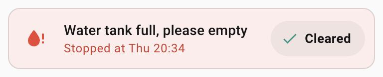

# Appliance alert card

`custom:appliance-alert-card` – an appliance that needs you, at the top of its page: "Water tank
full, please empty", when it stopped, and a **Cleared** button.

<p>
  
</p>

- **Only there while it matters.** The card shows while its `entity` (usually an `input_boolean`
  an automation turns on) is on. Otherwise it hides itself the way Home Assistant's conditional
  cards do, so the section closes up around it – no visibility conditions to set up. In the
  dashboard editor it stays visible as a preview ("Shows while … is on").
- **One row:** the glyph (red – a call for attention), the message, and under it **Stopped at
  20:34** ("at Thu 20:34" within the week, "on 15 Oct" before that) from the `since` helper,
  then the Cleared pill. The whole card glows red.
- **Cleared** turns the entity off at once (clearing an alert is harmless, so there is no
  dialog). It rests until the state changes; if the call fails, Home Assistant's message (or
  "Couldn't clear …") shows and it works again.
- Nothing is cut off: the message wraps, and when message and pill don't fit on one line the
  pill moves to a full-width row of its own (measured, not a breakpoint).

## Configuration

```yaml
type: custom:appliance-alert-card
entity: input_boolean.clothes_dryer_tank_alert
since: input_datetime.clothes_dryer_tank_full_since
```

| Option | What it is |
|---|---|
| `entity` | The alert: shown while on, turned off by Cleared (`input_boolean` or `switch`). Required. |
| `since` | When the appliance stopped: an `input_datetime` with date and time (its `timestamp` is read, not its zone-less state), or a timestamp sensor. Optional – without it the message stands alone. |
| `message` | Default "Water tank full, please empty". |
| `icon` | Default `mdi:water-alert`. |
| `clear_label` | Default "Cleared". |

Place it first on the appliance's page (the first card of the first section), so it is the first
thing you see when a phone notification opens that page.

## The automation behind it

The card only shows a state. A tank-full alert needs three helpers per appliance and one
automation – this is how the clothes dryer and the bedroom dehumidifier are set up:

- `binary_sensor.clothes_dryer_tank_full` – a template helper: on when the plug is on and the
  appliance draws under 5 W, with a *delay on* longer than any normal pause (2 min for a dryer
  that runs continuously, 30 min for a dehumidifier that rests 17 min between humidistat cycles).
- `input_boolean.clothes_dryer_tank_alert` – the latched alert this card shows.
- `input_datetime.clothes_dryer_tank_full_since` – when the power dropped to zero.

The automation, on the tank-full sensor turning on: stamp the time, turn the alert on, post a
Home Assistant notification and push to the phones (tapping it opens the appliance's page). On
the appliance drawing power again for a minute (the tank was emptied): turn the alert off. On
the alert turning off (that, or Cleared): dismiss the notification and clear the pushes.
