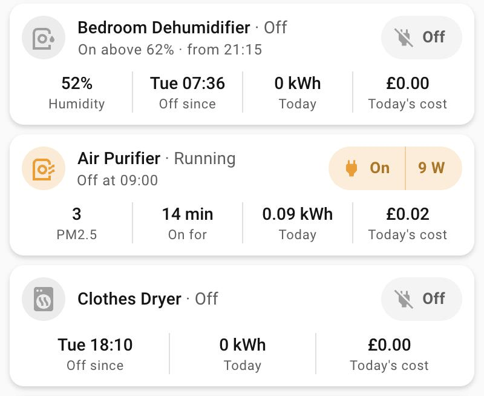

# Appliance card

`custom:appliance-card` – a plug-powered appliance (dehumidifier, air purifier, dryer…) in one card.

<p>
  
</p>

- **Head row:** the icon circle – orange while the appliance is on (power, like a lit room and
  the pill), grey while it is off – then
  "Name · Running" ("Idle" when it is on but drawing less than `idle_below`, "Off",
  "Unavailable"), and under it **what its automation does next**: "On at 17:30", "Off at 09:00",
  "On above 62% · from 21:15", or "… · until 06:50" inside the window. It reads the same helpers
  the automation uses, so the card and the automation can't disagree: change a helper and both
  follow. "Schedule off" when the automation is switched off; "Paused while away" when it only
  runs with someone home and nobody is.
- **Power pill**, as on the printer card: "On | 252 W" (orange) while on, "Off" while off. The
  left half switches the plug at once, both ways; the watts open the power sensor.
- **Today's numbers**, split by straight dividers: the reading (e.g. the room's humidity),
  **On for** 1 h 12 min (or **Off since** 07:00 / Tue 18:10 / 4 Oct), energy today and today's
  cost (in pence under a pound, "9p"; "£1.20" from a pound up). The run time comes from the history, so a Home Assistant restart (the plug briefly
  unavailable) doesn't reset it.
- **Tap anywhere but the pill** to open the appliance's own dashboard (`navigation_path`), or
  its more-info without one.
- Nothing is cut off: the name wraps, the state word moves to the next line whole, and the rule
  wraps only between its parts.

## Configuration

```yaml
type: custom:appliance-card
entity: switch.dehumidifier
name: Bedroom Dehumidifier
icon: mdi:air-humidifier
power: sensor.dehumidifier_power
energy: sensor.dehumidifier_energy_today
reading:
  entity: sensor.bedroom_air_quality_humidity
  name: Humidity
navigation_path: /lovelace/dehumidifier
schedule:
  turn_on:
    automation: automation.turn_on_dehumidifier_when_humid
    above: input_number.dehumidifier_on_above
    from: input_datetime.dehumidifier_on_from
    until: input_datetime.dehumidifier_on_until
  turn_off:
    automation: automation.turn_off_dehumidifier_in_the_morning
    at: input_datetime.dehumidifier_off_at
  presence: input_boolean.home_master
```

A timed one:

```yaml
type: custom:appliance-card
entity: switch.air_purifier
name: Air Purifier
power: sensor.air_purifier_power
energy: sensor.air_purifier_energy_today
reading: { entity: sensor.bedroom_pm2_5, name: PM2.5 }
navigation_path: /lovelace/air-purifier
schedule:
  turn_on: { automation: automation.air_purifier, at: input_datetime.air_purifier_on_at }
  turn_off: { automation: automation.air_purifier, at: input_datetime.air_purifier_off_at }
  presence: input_boolean.home_master
```

| Option | What it is |
|---|---|
| `entity` | The plug or switch (`switch`, `input_boolean`, `fan`, `light`, `humidifier`). Required. |
| `name`, `icon` | Default: the entity's friendly name and icon. |
| `power` | Power sensor (W): the watts in the pill, and Running vs Idle. |
| `energy` | Today's energy (kWh, Wh or MWh): the Today and cost cells. |
| `price` | Price per kWh, a number or a sensor. Default: the grid price in Settings → Energy. |
| `reading` | `{ entity, name }` – shown first in the numbers, e.g. the room's humidity. PM values go without their unit (always µg/m³). |
| `navigation_path` | Where a tap goes (default: the plug's more-info). |
| `idle_below` | On but drawing less than this (W) shows as Idle. Default 2. |
| `schedule.turn_on` | What turns it on, shown while it is off. |
| `schedule.turn_off` | What turns it off, shown while it is on. |
| `schedule.presence` | Who must be home for `turn_on` (input_boolean, person, zone…). While away: "Paused while away". |

Each rule takes the helpers its automation uses – an entity id (or a plain value):

| Rule key | Shows | Use it for |
|---|---|---|
| `automation` | "Schedule off" while it is off | The automation that applies the rule |
| `at` | "On at 17:30" | A time trigger (`input_datetime`, time only) |
| `above`, `below` | "On above 62%" | A `numeric_state` threshold (`input_number`); the unit is the helper's, else the reading's |
| `from`, `until` | "from 21:15" outside the window, "until 06:50" inside it | A `time` condition's `after` / `before`; windows may cross midnight |
| `text` | Its own words, split on " · " | Anything the keys above can't describe |

Point the automation at the same helpers – a time trigger `at: input_datetime.air_purifier_on_at`,
a time condition `after: input_datetime.dehumidifier_on_from`, a numeric state condition
`above: input_number.dehumidifier_on_above` – and the card follows any change to them. The window
is checked in Home Assistant's time zone, where the automation runs.
