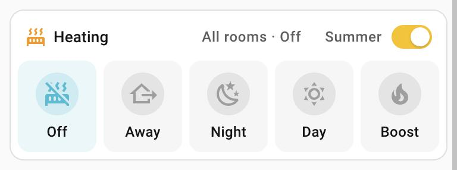

# Climate modes card

`custom:climate-modes-card` – whole-house mode shortcuts in one card.

<p>
  
</p>

- A label row: the icon, the title and – **under the title** – what the rooms are
  on, "All rooms · Night", or "Mixed" when they differ (just the mode's name when
  there are no `thermostats`). Optionally a switch at the end of the row (e.g.
  summer mode, or an automatic aircon automation): it toggles, or runs
  `switch_tap_action` instead – which can ask first (see below). The switch is teal
  when on, unless you give it a `switch_color`.
- The label icon takes the **active mode's colour**, and is grey when no mode is on
  (or the active one has no colour, like an Off tile) – teal instead when it is
  tappable (`header_tap_action`), since a tap target is never grey. Set `icon_color`
  to keep it one colour instead.
- Or, with `status: activity`, the line under the title says **what the heating is
  doing**, and the icon follows: "Heating · Living Room, Study" (orange, or your
  `icon_color`) while rooms call for heat (`hvac_action: heating`; "Heating · 3 rooms"
  when the names don't fit on one line), "Idle" (grey) when every room is satisfied,
  or your `lock` text and icon while a lock such as summer mode is on ("Summer ·
  heating locked", grey unless the lock has a `color`). The tiles below still show
  the mode.
- The line under the title is never cut off: it wraps, and only between its parts
  ("All rooms" and "Night" each stay whole).
- A tile per mode. The active one glows in its own colour; a mode without one (or a
  grey one, like Off) glows teal – "what you picked" – so you can always see which is on.
- **Tile names are never cut off or shrunk.** The tiles share one row at equal widths
  while every name fits. When they don't, the card measures the names and keeps one row
  with the tighter phone spacing (6px tile sides) if every tile still fits that way – the
  tiles stay as even as the names allow, a longer name's tile only as wide as it needs
  (six heating modes stay in one row on a phone from about 385 px wide, e.g. 402 or
  440 px). Only then does it lay the tiles out in even, balanced rows (3 + 3 on a 375 px
  phone, not 5 + 1). It fits again when the card is resized.
- A mode is active when **all** `thermostats` share its `preset`, or when its
  own `active.entity` is in `active.state` (handy for an aircon speed helper).
- A **flag tile** uses `active: { attribute, state }` and glows on its own, next to the
  active mode, when every thermostat's attribute is one of `state` – e.g. a Schedule tile
  with `active: { attribute: schedule_override_active, state: [false] }` is green while
  every room follows its schedule. It stays dark while a `lock` (summer mode) is on.
- Tapping a tile runs its `tap_action`: `perform-action` (scripts, services),
  `navigate`, `more-info`, `toggle`. Errors (e.g. heating locked in summer mode) show as a
  toast – Home Assistant's own message, else "Couldn't switch to Night." (or "Couldn't
  turn Summer mode off." for the switch, by its friendly name).
- **Ask first:** add `confirmation` to any tap action (a tile's, the switch's or the
  header's). The card shows its own confirm dialog in the same look as every card's: the
  icon and a title, a line of text under the title, then Confirm / Cancel below a rule.
  It takes the colour of what you tapped – the tile's colour (teal for a tile without
  one or a grey one, since a filled grey button would look disabled), the switch's (teal
  by default), or the label icon's as it is now (teal while it is grey). Escape or a tap outside cancels. Every text may be a Home Assistant
  template, rendered when the dialog opens. No pop-up card is needed.

  | `confirmation` key | Default |
  |---|---|
  | `true` | Just the tile's name |
  | `title` | The tile's name (the switch's label for the switch) |
  | `icon` | The tile's icon |
  | `text` | none – what will happen, under the title |
  | `confirm_label` | The title |

  The older `subject` / `subject_icon` keys no longer get a line of their own: a
  `subject` is shown as the text when there is no `text`, and `subject_icon` is ignored.

## Configuration

```yaml
type: custom:climate-modes-card
title: Heating
icon: mdi:radiator
thermostats:
  - climate.living_room_thermostat
  - climate.master_bedroom_thermostat
  - climate.second_bedroom_thermostat
  - climate.study_thermostat
modes:
  - name: "Off"
    icon: mdi:radiator-off
    color: grey
    preset: frost_protection
    tap_action: { action: perform-action, perform_action: script.heating_mode_frost_protection }
  - name: Away
    icon: mdi:home-export-outline
    color: grey
    preset: away
    tap_action:
      action: perform-action
      perform_action: script.heating_mode_away
      confirmation:
        title: Away mode
        text: Every room drops to its away temperature until you pick another mode.
        confirm_label: Set to Away
  - name: Day
    icon: mdi:weather-sunny
    color: orange
    preset: comfort
    tap_action: { action: perform-action, perform_action: script.heating_mode_comfort }
switch: input_boolean.heating_summer_mode
switch_name: Summer
switch_tap_action:
  action: toggle
  confirmation:
    title: "{{ 'Turn off' if is_state('input_boolean.heating_summer_mode', 'on') else 'Turn on' }} summer mode"
    text: Every thermostat is locked at 5 °C while summer mode is on.
```

Cooling example (entity + state modes and a switch in the label row):

```yaml
type: custom:climate-modes-card
title: Cooling
icon: mdi:snowflake
switch: automation.85_turn_on_aircon_when_hot
modes:
  - name: "Off"
    icon: mdi:snowflake-off
    active: { entity: input_number.aircon_state, state: ["0", "0.0"] }
    tap_action: { action: perform-action, perform_action: script.aircon_off }
  - name: Low
    icon: mdi:fan-speed-1
    color: blue
    active: { entity: input_number.aircon_state, state: ["1", "1.0"] }
    tap_action: { action: perform-action, perform_action: script.aircon_low }
```

| Option | What it is |
|---|---|
| `title`, `icon`, `icon_color` | Label row. The icon takes the active mode's colour (grey when none) unless `icon_color` sets one; with `status: activity`, `icon_color` is the heating colour (default orange). Colours are Home Assistant colour names (`orange`, `grey`, …) or any CSS colour. |
| `thermostats` | Climate entities whose shared preset picks the active mode. |
| `switch`, `switch_name`, `switch_color` | Optional switch at the end of the label row. Teal when on unless `switch_color` is set. |
| `status` | `mode` (default) shows the active mode under the title; `activity` shows what the heating is doing (see above). |
| `lock` | With `activity`: `{ entity, text, icon, color }` – while `entity` is on, the label row shows this instead, e.g. `{ entity: input_boolean.heating_summer_mode, text: "Summer · heating locked", icon: mdi:weather-sunny }`. Grey unless `color` is set. |
| `names` | With `activity`: room names per thermostat, e.g. `{ climate.study_thermostat: Study }`. Default: the friendly name without "Thermostat". |
| `header_tap_action` | Makes the label row a link: the icon (which gets a filled circle), the title and the status line all run it, e.g. `{ action: navigate, navigation_path: /lovelace/climate }`. The switch keeps its own action. (`icon_tap_action` is the older name.) |
| `switch_tap_action` | What tapping the switch does instead of toggling, e.g. `{ action: toggle, confirmation: { title: Summer mode } }` to ask first. |
| `modes[].name`, `icon`, `color` | The tile. Use the colour's meaning: orange for heat, blue for cooling, grey for Off / Away. |
| `modes[].preset` | Active when every thermostat has this preset. |
| `modes[].active` | `{ entity, state }` – active when the entity is in that state (one value or a list). |
| `modes[].tap_action` | What a tap does (see above). |

In the visual editor the modes are edited as YAML.
