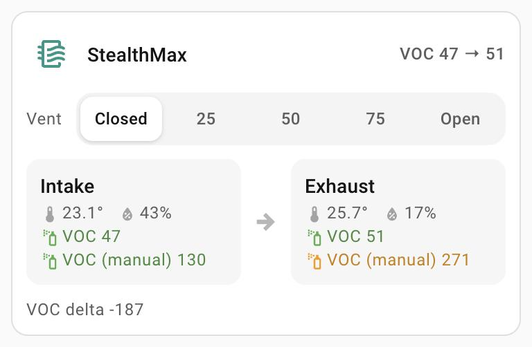

# Enclosure filter card

`custom:enclosure-filter-card` – a printer enclosure's filter and vent (e.g. a
StealthMax).

<p>
  
</p>

- **Label row**: the title with the summary under it ("VOC 312 → 96", and "Vent: Manual" when
  the vent isn't at a position); it wraps between its parts, never cut. The filter icon is
  decoration, so it is grey.
- **Vent**: the numeric options of the select as segments (`0` reads Closed,
  `100` Open), in the same segmented style as the robot vacuum card's settings. Tap one to
  move the vent: the selection moves at once and stays while Home Assistant catches up; it
  falls back if Home Assistant refuses (with its message, or "Couldn't move the vent.") or
  hasn't confirmed within 45 s. A label too long for its segment wraps; nothing is cut off.
  A non-numeric state (e.g. Manual) lights no segment and shows in the summary.
- **Intake → exhaust**: temperature (`31.2°`), humidity (`29%`), VOC index and the VOC index
  with manual calibration, VOC coloured by the same tiers as the air quality card
  (green, amber from 150, orange from 250, red from 400).
- **Extra line**: any other readings, e.g. the VOC delta, each with its unit
  (`1.1°`, `48%`, `1,204 ppm`; `–` while unavailable).
- Tap any value for its own more-info; the rest of a side opens its VOC sensor.

## Configuration

```yaml
type: custom:enclosure-filter-card
title: StealthMax
vent: select.stealthmax_vent_position_0_closed_100_open
intake:
  temperature: sensor.stealthmax_intake_temperature
  humidity: sensor.stealthmax_intake_humidity
  voc: sensor.stealthmax_intake_voc
  voc_manual: sensor.stealthmax_intake_voc_manual_calibration
exhaust:
  temperature: sensor.stealthmax_exhaust_temperature
  humidity: sensor.stealthmax_exhaust_humidity
  voc: sensor.stealthmax_exhaust_voc
  voc_manual: sensor.stealthmax_exhaust_voc_manual_calibration
details:
  - entity: sensor.stealthmax_intake_exhaust_voc_delta
    name: VOC delta
```

| Option | What it is |
|---|---|
| `title` | Label row title. Default `Filter`. |
| `vent` | A `select` / `input_select` whose options are positions. |
| `intake`, `exhaust` | `temperature`, `humidity`, `voc`, `voc_manual` sensors; any can be left out. |
| `intake_name`, `exhaust_name` | Side titles. Default Intake / Exhaust. |
| `details` | List of `{entity, name}` (or entity ids), shown as one small line with each reading's unit. |
